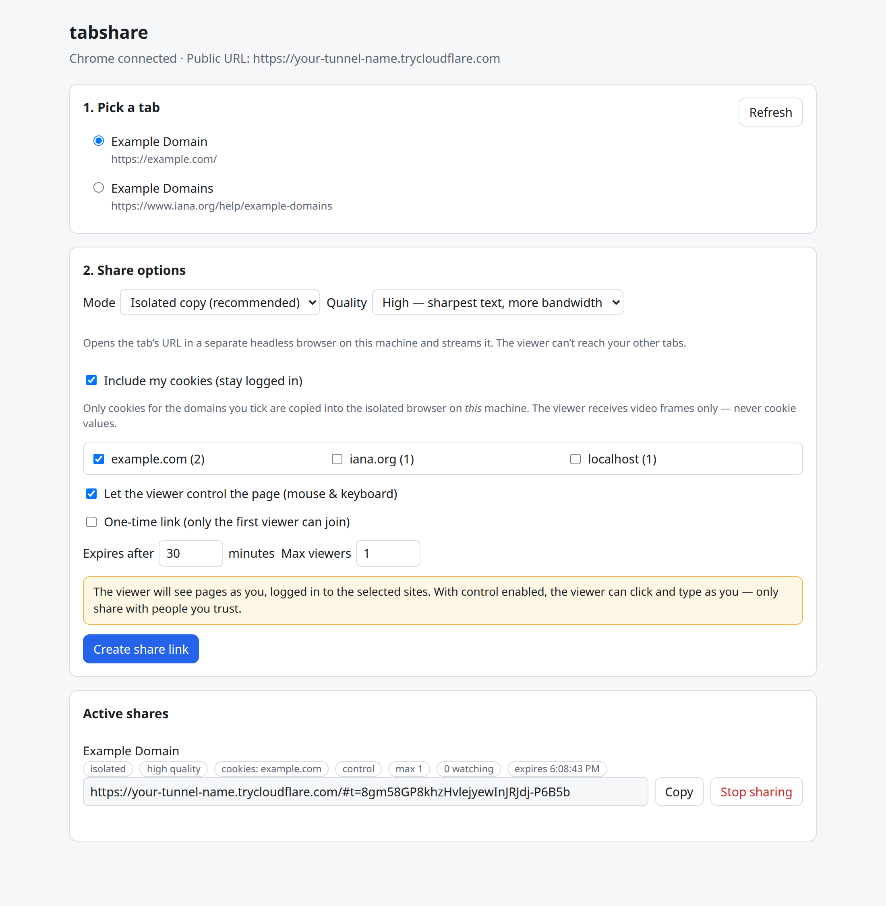
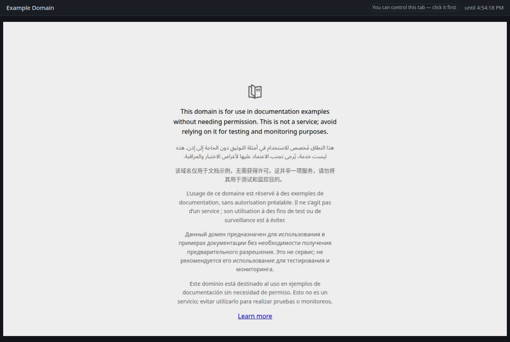
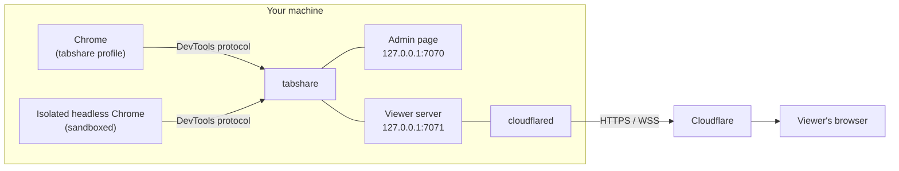

<div align="center">

# tabshare

**Share a Chrome tab with anyone, anywhere: a live view in their browser, never your cookies.**

[](https://github.com/ZakariaMahmoud/tabshare/actions/workflows/ci.yml)
[](LICENSE)
[](package.json)
[](https://developers.cloudflare.com/cloudflare-one/connections/connect-networks/)

[Quick start](#quick-start) · [How it works](#how-it-works) · [Security](#security) · [Configuration](#configuration) · [FAQ](#faq)

</div>

<table>
  <tr>
    <td width="50%" align="center"><b>You</b>: choose a tab and how much to share</td>
    <td width="50%" align="center"><b>Your viewer</b>: watches (or controls) it live</td>
  </tr>
  <tr>
    <td></td>
    <td></td>
  </tr>
</table>

tabshare runs on your machine, attaches to a Chrome window, and streams one tab to a link you send.
The link works from anywhere through a [Cloudflare quick tunnel](https://developers.cloudflare.com/cloudflare-one/connections/connect-networks/do-more-with-tunnels/trycloudflare/),
so you need no port forwarding, no server and no account. Your viewer only needs a browser.

> [!IMPORTANT]
> **Cookies never leave your machine.** Viewers receive only JPEG images of the rendered page,
> never cookie values, HTML or network traffic. "Include my cookies" means *the page is rendered
> logged in as you, on your machine*. It does not hand your session to anyone.

---

## Contents

- [Features](#features)
- [Requirements](#requirements)
- [Quick start](#quick-start)
- [Using tabshare](#using-tabshare)
- [Share options](#share-options)
- [How it works](#how-it-works)
- [Configuration](#configuration)
- [Security](#security)
- [Limitations](#limitations)
- [Troubleshooting](#troubleshooting)
- [FAQ](#faq)
- [Roadmap](#roadmap)
- [Contributing](#contributing)
- [License](#license)

## Features

- 🔗 **One link, any browser.** Viewers open a URL and see the tab live. Nothing to install.
- 🧪 **Isolated by default.** The tab's page is opened in a separate, sandboxed headless browser, so viewers can't reach your other tabs.
- 🍪 **Optional login state.** Copy cookies for only the domains you tick into that isolated browser.
- 🪞 **Mirror mode.** Stream your real tab exactly as you see it.
- 🖱️ **Optional remote control.** Mouse and keyboard, validated and rate-limited. View-only by default.
- 🎚️ **Quality presets.** Low, Standard and High, with 2× sharp text in isolated mode, plus **Fit / Actual size** in the viewer.
- ⏱️ **Link controls.** Expiry, instant revoke, one-time links and a cap on viewers.
- 🛡️ **Hardened.** Localhost-only admin page with a per-run key, and an isolated browser blocked from your machine and LAN. See [SECURITY.md](SECURITY.md).

## Requirements

| Requirement | Notes |
| --- | --- |
| [Node.js](https://nodejs.org/) 20+ | 22.5+ only for `npm run coverage` |
| Google Chrome or Chromium | tabshare uses its own Chrome profile |
| [`cloudflared`](https://developers.cloudflare.com/cloudflare-one/connections/connect-networks/downloads/) | Creates the public link; no Cloudflare account needed |

## Quick start

```bash
git clone https://github.com/ZakariaMahmoud/tabshare && cd tabshare
npm install
```

**1. Start Chrome with tabshare's profile.** A separate Chrome window opens. Log in to whatever you want to share *in that window*.

```bash
npm run chrome
```

**2. Start tabshare** in a second terminal:

```bash
npm start
```

```text
[chrome] connected to http://127.0.0.1:9222
[tunnel] starting Cloudflare quick tunnel…

  Admin (this machine only): http://127.0.0.1:7070/#k=<per-run admin key>
  Public viewer URL:         https://<random-words>.trycloudflare.com
```

**3. Open the admin link** printed in your terminal. It includes a per-run key, so the plain address won't work.

> [!TIP]
> Port 7070 already taken? Run `TABSHARE_ADMIN_PORT=7080 TABSHARE_VIEWER_PORT=7081 npm start`.

## Using tabshare

1. **Pick a tab.** The admin page lists the http(s) tabs open in the tabshare Chrome window. Click **Refresh** after opening new ones.
2. **Choose share options.** Pick the mode, quality, cookies, control, one-time use, expiry and max viewers. A yellow warning appears whenever your choices let the viewer act as you.
3. **Create the link and send it.** Click **Create share link**, then **Copy**. The share card shows how many people are watching and when the link expires.
4. **Stop sharing** whenever you like. The viewer sees *"Sharing ended"* immediately. Stopping tabshare (<kbd>Ctrl</kbd>+<kbd>C</kbd>) revokes every link.

**For the viewer:** the top bar shows whether they can control the tab, the stream quality, and when the link expires.
**Actual size** shows the page 1:1 for the sharpest text, and **Fit to window** scales it down.
With control enabled, they click into the page first, then use the mouse and keyboard as usual.

## Share options

| Option | Default | What it does |
| --- | --- | --- |
| **Mode: Isolated copy** | ✅ | Opens the tab's URL in a separate sandboxed headless browser on your machine and streams that. |
| ↳ **Include my cookies** | off | Copies cookies for the domains **you tick** into the isolated browser, so the page loads logged in. |
| **Mode: Mirror my real tab** | | Streams your actual tab. Keep it in the foreground for smooth video. |
| **Quality** | Standard | **Low** for slow connections. **High** renders isolated pages at 2× for crisp text, at a lower frame rate and with more bandwidth. |
| **Let the viewer control the page** | off | Mouse and keyboard input from the viewer. |
| **One-time link** | off | Only the first person to open the link gets in. |
| **Expires** | after 30 min | After N minutes, hours or days, **or at a date and time** you pick, up to **7 days** ahead. Revoke any time before that. |
| **Max viewers at once** | 1 | How many people can watch at the same time (up to 10). With 1, a second person is turned away while someone is watching. |

## How it works



- tabshare attaches to your Chrome over the DevTools protocol (Playwright `connectOverCDP`).
- **Isolated** shares open the tab's URL in a fresh, sandboxed headless browser context, seeded only with the cookies you selected.
- Frames come from Chrome's screencast and are sent over a WebSocket. Streaming runs only while someone is watching.
  - **High** quality on isolated shares uses full-resolution screenshots instead (about 5 per second, sent only when the picture changes), because the screencast always captures at 1×.
- The share token lives in the URL **fragment** (`#t=…`). Browsers never send fragments in HTTP requests, so the token doesn't appear in Cloudflare or proxy logs. The viewer page presents it over the WebSocket, then clears it from the address bar.
- Viewer input is checked against a strict schema, rate-limited, and replayed in order through Playwright's mouse and keyboard APIs.

## Configuration

All settings are environment variables.

| Variable | Default | Description |
| --- | --- | --- |
| `TABSHARE_ADMIN_PORT` | `7070` | Local admin page port |
| `TABSHARE_VIEWER_PORT` | `7071` | Viewer server port. This is the only port the tunnel exposes. |
| `TABSHARE_CDP_URL` | `http://127.0.0.1:9222` | Chrome DevTools endpoint |
| `TABSHARE_PUBLIC_URL` | | Your own domain or [named tunnel](https://developers.cloudflare.com/cloudflare-one/connections/connect-networks/get-started/) instead of a quick tunnel |
| `TABSHARE_TUNNEL` | `1` | `0` disables the built-in quick tunnel |
| `TABSHARE_TUNNEL_PROTOCOL` | `http2` | `cloudflared` transport. `http2` works on networks that block QUIC/UDP. |
| `CLOUDFLARED_BIN` | `cloudflared` | Path to `cloudflared` |
| `TABSHARE_CHROME_CHANNEL` | `chrome` | Browser for isolated shares (`chrome`, `chromium`, `msedge`) |
| `TABSHARE_JPEG_QUALITY` | `80` | JPEG quality of the **Standard** preset (1–100) |
| `TABSHARE_NO_SANDBOX` | | `1` disables Chrome's sandbox for isolated shares. Use this only where it can't start, such as some containers. |
| `TABSHARE_PROFILE_DIR` | `~/.tabshare/chrome-profile` | Profile used by `npm run chrome` |
| `TABSHARE_CDP_PORT` | `9222` | DevTools port used by `npm run chrome` |

<details>
<summary><b>Use a stable address with a named tunnel</b></summary>

```bash
cloudflared tunnel create tabshare
cloudflared tunnel route dns tabshare share.example.com
cloudflared tunnel run --url http://127.0.0.1:7071 tabshare
# in another terminal
TABSHARE_PUBLIC_URL=https://share.example.com npm start
```

Put [Cloudflare Access](https://developers.cloudflare.com/cloudflare-one/policies/access/) in front of the hostname to require viewers to sign in as well.

</details>

## Security

The full threat model is in [SECURITY.md](SECURITY.md). In short:

| Protection | How |
| --- | --- |
| Cookies stay local | Viewers get images only. The admin API exposes cookie *domains and counts*, never values. |
| Admin page stays local | Bound to `127.0.0.1`, never tunneled, guarded by a per-run key, a `Host` check and a `Sec-Fetch-Site` check |
| Links are hard to guess and easy to kill | 192-bit tokens compared in constant time, plus expiry, revoke, one-time use and a viewer cap |
| Isolated browser is contained | Chrome sandbox on, and requests to loopback, private and link-local addresses blocked (including via DNS). Downloads are off and popups are closed. |
| Input is constrained | Strict schema, 120 messages/s, ordered replay. **Ctrl/Cmd+V is refused**, so a viewer can't paste *your* clipboard. |

> [!WARNING]
> With **mirror** mode, or **cookies plus control**, the viewer can do anything on those sites that you could do with a mouse and keyboard. Only share with people you trust, keep expiries short, and prefer view-only.

Found a vulnerability? Please report it privately; see [SECURITY.md](SECURITY.md).

## Limitations

- **One tab per link.** Create one link per tab.
- **Links live as long as tabshare does.** A link can be set to last up to 7 days, but tabshare and its Chrome window must keep running, and the computer must stay awake. Restarting tabshare ends every link, and quick-tunnel addresses change. For multi-day sharing, use a [named tunnel](#configuration).
- **Isolated shares are a single page.** Popups and new tabs are closed, and downloads are disabled. Viewers can't type an address; they can only follow links on the page.
- **Mirror needs the tab in the foreground.** Chrome slows or pauses rendering for background tabs.
- **Keyboard control uses an allowlist.** Typing, arrows, Tab and Enter work, plus Ctrl/Cmd + A, C, X, Y, Z. Viewers paste *their own* text with their usual paste shortcut.
- **Built for reading and clicking, not video.** For the sharpest text use **High** quality plus **Actual size**. In mirror mode, High only raises JPEG quality, because your real tab keeps your own screen's pixel density.

## Troubleshooting

| Problem | Fix |
| --- | --- |
| `port 7070 is already in use by another program` | Use free ports: `TABSHARE_ADMIN_PORT=7080 TABSHARE_VIEWER_PORT=7081 npm start` |
| Public URL shows **error 530** | The tunnel isn't connected yet. tabshare waits for the connection before printing the URL. If it times out, your network may block outbound port 7844. |
| `Chrome NOT connected` | Start Chrome with `npm run chrome` first, then restart tabshare. Make sure nothing else uses port 9222. |
| `401 missing or invalid admin key` | Open the full admin link from the terminal, including `#k=…`. The key changes on every restart. |
| A tab isn't listed | Only http(s) tabs in the **tabshare Chrome window** are listed. Click **Refresh**. |
| Isolated shares fail in a container | Chrome's sandbox may be unavailable there. Set `TABSHARE_NO_SANDBOX=1` after reading [SECURITY.md](SECURITY.md). |

## FAQ

<details>
<summary><b>Does my viewer need an account or any software?</b></summary>

No. A modern browser and the link are enough.
</details>

<details>
<summary><b>Can the viewer steal my login?</b></summary>

They never receive cookies or tokens, only images. With control enabled they can still *act* on the page as you while the link is active, so only enable control for people you trust.
</details>

<details>
<summary><b>Why a separate Chrome window instead of my normal one?</b></summary>

Chrome 136+ blocks remote debugging on your default profile. A dedicated profile also means tabshare can only ever see the tabs you deliberately open there.
</details>

<details>
<summary><b>Why can't a second person open my link?</b></summary>

New links allow **one viewer at a time** by default. Raise **Max viewers at once** before creating the link. The share card shows how many people are watching, for example *1/2 watching*. Viewers can reload the page without losing their place.
</details>

<details>
<summary><b>Is the public address permanent?</b></summary>

Quick-tunnel addresses change every time tabshare starts. For a fixed address, use a [named tunnel](#configuration) with `TABSHARE_PUBLIC_URL`.
</details>

<details>
<summary><b>Can I share a local dev server, like <code>http://localhost:3000</code>?</b></summary>

Yes. Open it in the tabshare Chrome window and share it. In isolated mode the shared page's own origin is allowed, while every other local address stays blocked.
</details>

## Roadmap

Planned improvements are tracked as issues. Contributions are welcome:

- [ ] Share several tabs in one link ([ZakariaMahmoud/tabshare#1](https://github.com/ZakariaMahmoud/tabshare/issues/1))
- [ ] Address bar with back / forward / reload in the viewer ([ZakariaMahmoud/tabshare#2](https://github.com/ZakariaMahmoud/tabshare/issues/2))
- [ ] Separate code required to take control ([ZakariaMahmoud/tabshare#3](https://github.com/ZakariaMahmoud/tabshare/issues/3))
- [x] Stream quality options ([ZakariaMahmoud/tabshare#4](https://github.com/ZakariaMahmoud/tabshare/issues/4))

## Contributing

```bash
npm test          # unit + integration tests, no browser needed
npm run coverage  # Node 22.5+
```

Read [CONTRIBUTING.md](CONTRIBUTING.md) before opening a pull request, especially the security notes. Anything reachable through the tunnel is internet-facing.

## License

[MIT](LICENSE) © tabshare contributors
